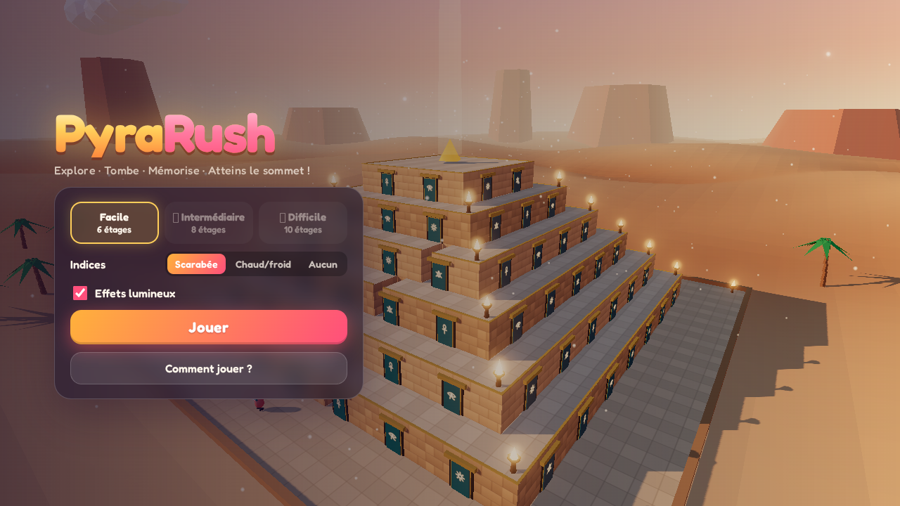
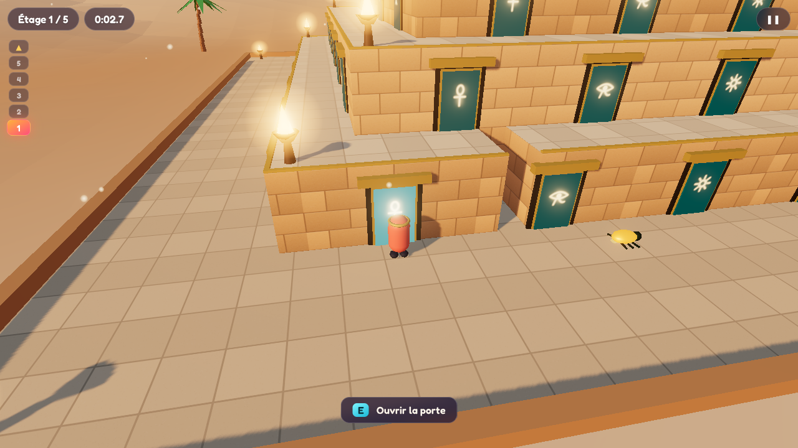
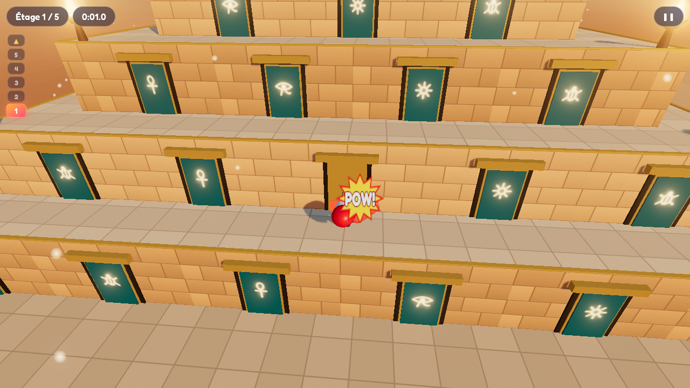
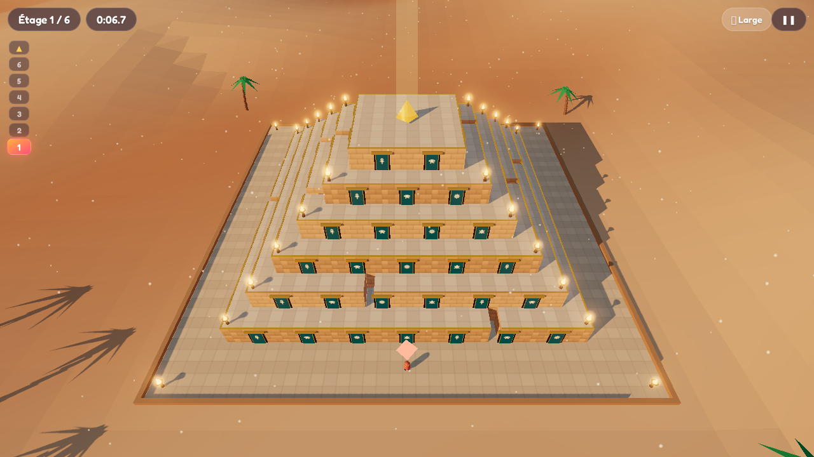
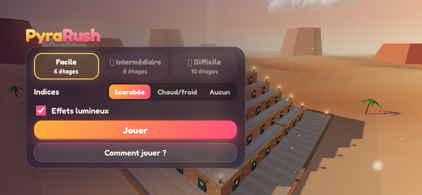

# PyraRush

**Course en 3D au sommet d'une pyramide, jouable directement dans le navigateur, sur ordinateur comme sur smartphone.**

Explore les portes de la pyramide pour découvrir les passages secrets, évite les pièges, mémorise ton chemin et atteins le sommet le plus vite possible. Six niveaux à débloquer, chacun avec son décor, ses couleurs, sa musique et de nouveaux pièges.



> Statut : **V1, prototype solo jouable.** Les robots et le multijoueur sont prévus pour la V2 (voir la [feuille de route](#feuille-de-route)).

---

## Sommaire

- [Le jeu](#le-jeu)
- [Commandes](#commandes)
- [Démarrage rapide](#démarrage-rapide)
- [Scripts](#scripts)
- [Paramètres d'URL](#paramètres-durl)
- [Architecture](#architecture)
- [Ajouter un niveau](#ajouter-un-niveau)
- [Ajouter une mécanique de porte](#ajouter-une-mécanique-de-porte)
- [Tests](#tests)
- [Choix techniques](#choix-techniques)
- [Feuille de route](#feuille-de-route)
- [Documentation de design](#documentation-de-design)

---

## Le jeu

La pyramide est **à degrés** : chaque étage est une terrasse qui fait le tour complet de la pyramide. Sa paroi est percée de portes. Pour monter, il faut trouver les bonnes portes.

| Porte | Effet |
|---|---|
| **Passage** | Tu montes d'un étage. Il s'illumine quelques secondes pour tous les joueurs. |
| **Mur** | Rien ne se passe… mais un indice t'aide (voir ci-dessous). |
| **Piège** | Un **gant de boxe** jaillit (« POW ! ») et t'envoie à l'étage du dessous. |
| **Porte risquée ±N** | Dorée et reconnaissable : un pari, **+N ou −N étages**. Un seul essai par partie. |
| **Gant géant** | Gros piège : plusieurs étages perdus (niveaux avancés). |
| **Téléporteur** | Fait monter de plusieurs étages : rare, pour revenir dans la course (niveaux avancés). |
| **Téléporteur piégé** | Renvoie plusieurs étages plus bas (niveaux avancés). |

**Les règles qui comptent :**

- **Les portes ne changent jamais pendant une partie** : ce que tu apprends reste vrai. Une nouvelle partie génère une nouvelle disposition.
- **Une chute fait perdre de la progression, pas la mémoire.** Les passages que tu as déjà trouvés restent marqués en doré, pour toi seul.
- **Les terrasses ont des trous** : saute par-dessus, sinon tu tombes à l'étage du dessous.
- **Règle d'or du design** : tes décisions doivent compter davantage que la chance. Les paris sont visibles, les indices permettent de déduire.

### Indices (au choix dans le menu)

| Mode | Fonctionnement |
|---|---|
| **Scarabée** (par défaut) | Un scarabée doré sort du mur et détale vers le passage le plus proche. S'il s'agite et scintille, c'est tout près. |
| **Chaud / froid** | La porte devient rouge, orange ou bleue selon la distance du passage. |
| **Aucun** | Pure mémoire et observation. |

| Le scarabée indique la direction | Un piège déclenche le gant de boxe |
|---|---|
|  |  |

### Niveaux

Chaque niveau se débloque en terminant le précédent (progression enregistrée dans le navigateur). Chaque niveau a son **thème** (ciel, lumière, décor, pierres, portes, particules, musique, couleurs de l'interface) et apporte une nouveauté de jeu.

| # | Niveau | Étages | Nouveauté | Ambiance |
|---|---|---|---|---|
| 1 | Le Temple des Sables | 6 | Passages, murs, gants de boxe, porte ±2 | Désert doré en fin d'après-midi, oasis |
| 2 | L'Oasis Émeraude | 6 | Gant géant (−2) | Prairies vertes, ciel turquoise, flammes vertes |
| 3 | Le Crépuscule Pourpre | 8 | Téléporteurs (+2) | Coucher de soleil rose et violet |
| 4 | La Pyramide de Glace | 8 | Téléporteurs piégés, porte ±3 | Neige qui tombe, pierres de glace, sapins |
| 5 | Le Sanctuaire de Lave | 10 | Pièges jusqu'à −4 | Volcans, lave lumineuse, braises |
| 6 | La Cité Céleste | 10 | Le défi ultime : −5, +4, paris ±3 | Nuit étoilée, cristaux lumineux |

### Son

Musique et effets sonores sont **générés en direct** (Web Audio API) : aucun fichier audio. Chaque thème a sa musique (gamme, tempo, instrument, rythme). Les effets sont volontairement cartoon : ressort du gant de boxe, sifflet de chute, « wah-wah » de trombone quand on perd un pari, grésillement du scarabée, fanfare de victoire. Musique et sons se règlent séparément dans le menu ; le bouton 🔊 coupe tout en jeu.

### Caméra

La caméra est automatique : elle reste à l'extérieur de la pyramide et la contourne quand tu longes une terrasse. Trois niveaux de zoom sont proposés : **Proche**, **Moyen** et **Large**. En zoom large, toute la pyramide est visible.



---

## Commandes

### Ordinateur

| Action | Touche |
|---|---|
| Se déplacer | **ZQSD** (AZERTY) / **WASD** (QWERTY) / flèches |
| Sauter | **Espace** |
| Ouvrir une porte | **E** ou **Entrée** |
| Tourner la caméra | Glisser avec la souris |
| Zoom | Molette, **C** (changer de niveau), **+** / **−** |
| Pause | **Échap** ou **P** |

Les touches sont lues par leur **position physique**, si bien qu'AZERTY et QWERTY fonctionnent sans réglage.

### Smartphone (mode paysage conseillé)

| Action | Commande |
|---|---|
| Se déplacer | Joystick virtuel (moitié gauche de l'écran) |
| Sauter | Bouton **SAUT** |
| Ouvrir une porte | Bouton **AGIR** (il pulse quand une porte est à portée) |
| Tourner la caméra | Glisser le doigt sur la moitié droite |
| Zoom | Bouton **🔍** |



---

## Démarrage rapide

**Prérequis : Node.js 22 ou plus** (et npm).

```bash
git clone git@github.com:madourimohamed/pyrarush.git
cd pyrarush
npm install
npm run dev
```

Ouvre ensuite **http://localhost:5173**.

### Tester sur un téléphone

`npm run dev` expose aussi le jeu sur le réseau local. Depuis le téléphone, connecté au même Wi-Fi, ouvre l'adresse **Network** affichée dans le terminal (par exemple `http://192.168.1.20:5173`).

> **WSL2** : il faudra peut-être autoriser le port 5173 dans le pare-feu Windows, ou activer le mode réseau « mirrored » de WSL.

### Build de production

```bash
npm run build
npm run preview
```

Le dossier `dist/` est un site **100 % statique**. Il s'héberge gratuitement (GitHub Pages, Cloudflare Pages, Netlify…).

---

## Scripts

| Commande | Rôle |
|---|---|
| `npm run dev` | Serveur de développement avec rechargement à chaud |
| `npm test` | Tests du moteur de règles (Vitest) |
| `npm run typecheck` | Vérification des types TypeScript |
| `npm run build` | Vérification des types, puis build de production dans `dist/` |
| `npm run preview` | Sert le build de production en local |

---

## Paramètres d'URL

| Paramètre | Effet | Exemple |
|---|---|---|
| `seed` | Rejoue exactement la même pyramide (la graine est affichée en fin de partie) | `?seed=4242` |
| `debloquer` | Débloque les niveaux jusqu'au numéro indiqué (pour tester) | `?debloquer=6` |
| `indices` | Force le mode d'indice | `?indices=hotCold` (`scarab`, `hotCold`, `none`) |

En développement, `window.__session()` donne accès à la partie en cours depuis la console.

---

## Architecture

Le projet est organisé en **trois couches** :

1. **`src/core/` — le socle.** Le cœur du jeu : moteur de règles, mécaniques des portes, génération des pyramides, géométrie, et la *forme* d'un niveau et d'un thème. TypeScript pur, sans 3D ni DOM : il sera réutilisé tel quel par les robots et le serveur (V2).
2. **`src/levels/` — les niveaux.** Un fichier par niveau, qui ne contient **que des données** : règles (étages, contenu des portes, trous, limites) et thème (graphismes, couleurs, musique). On construit un niveau à partir du socle, sans toucher au moteur.
3. **`src/client/` — l'affichage.** Rendu 3D, commandes, interface et son. Il sait jouer et afficher n'importe quel niveau.

```
src/
├── core/                  ← socle : aucune dépendance 3D ni DOM
│   ├── level.ts             forme d'un niveau, valeurs par défaut, band(), buildLevels()
│   ├── theme.ts             forme d'un thème + thème de base, defineTheme()
│   ├── mechanics/           un type de porte = un module
│   │   ├── mechanic.ts        interface Mechanic
│   │   ├── basic.ts           passage, mur (indices), petit piège
│   │   ├── advanced.ts        gros piège, téléporteurs, porte risquée
│   │   └── registry.ts        enregistrement des mécaniques
│   ├── layout.ts            génération déterministe par graine + garantie « terminable »
│   ├── geometry.ts          géométrie de la pyramide à degrés, boîtes de collision
│   ├── game.ts              état de la partie : actions → événements
│   ├── rng.ts               générateur pseudo-aléatoire (mulberry32)
│   └── core.test.ts         tests du moteur et des niveaux
├── levels/                ← un fichier par niveau (données uniquement)
│   ├── 01-temple-des-sables.ts … 06-cite-celeste.ts
│   ├── shared.ts            briques de règles réutilisables entre niveaux
│   └── index.ts             ordre de progression des niveaux
└── client/                ← navigateur uniquement
    ├── main.ts              écrans, niveaux et progression, options, boucle de rendu
    ├── session.ts           relie moteur, physique, rendu, son et commandes
    ├── physics.ts           contrôleur de personnage (collisions boîtes alignées)
    ├── camera.ts            caméra automatique et zoom
    ├── render.ts            renderer Three.js + lueur (bloom)
    ├── audio/               son généré : synth.ts, sfx.ts (effets), music.ts (séquenceur), audio.ts
    ├── input/input.ts       clavier, souris, joystick tactile
    ├── ui/hud.ts            interface en jeu
    └── scene/
        ├── world.ts           pyramide, portes, braseros (couleurs du thème)
        ├── environment.ts     ciel, sol, montagnes, nuages, plan d'eau, végétation, particules
        ├── props.ts           scarabée, gant de boxe
        ├── character.ts       personnage
        ├── textures.ts        textures procédurales (canvas, aucun fichier image)
        └── fx.ts              animations et particules
```

### Flux d'une interaction

```
Joueur appuie sur E
  → session.ts trouve la porte la plus proche
  → game.interact(joueur, porte, temps, position)        (core, pur)
      → la mécanique de la porte calcule l'effet
      → le moteur borne l'effet selon la pyramide
      → renvoie des événements : doorResult, publicReveal, floorChanged, victory
  → session.ts joue les animations (gant, scarabée, passage…) et met à jour l'interface
```

Le moteur ne connaît ni Three.js ni le DOM, et le temps lui est toujours fourni. En V2, un serveur appellera exactement les mêmes méthodes, et un robot enverra les mêmes actions qu'un humain.

---

## Ajouter un niveau

1. Copier un fichier existant, par exemple `src/levels/06-cite-celeste.ts`, en `src/levels/07-mon-niveau.ts`.
2. Régler les **règles** et le **thème** :

   ```ts
   import { band, defineLevel, defineTheme } from '../core';

   export default defineLevel({
     name: 'Mon niveau',
     tagline: 'Ce que ce niveau apporte de nouveau.',
     rules: {
       floors: 8,                // nombre d'étages
       maxFloorsLost: 3,         // perte maximale en un seul effet
       maxFloorsGained: 2,       // gain maximal (téléporteurs, paris)
       protectedTopFloors: 2,    // un bonus ne dépose jamais sur ces derniers étages
       bands: [
         //   étages  passages  autres portes                          trous
         band(1, 3,   3,        { smallTrap: 3, teleportUp: [0, 1] },  [1, 2]),
         band(4, 8,   2,        { smallTrap: 3, bigTrap: 2 },          [2, 3]),
       ],
       limits: { teleportUp: 2 },              // maximum sur toute la pyramide
       settings: { teleportUp: { min: 2, max: 2 } },
     },
     // Le thème ne déclare que ce qui diffère du thème de base.
     theme: defineTheme({
       sky: { top: 0x1a3a6a, mid: 0x6aa0d6, horizon: 0xd6ecff, sun: 0xffffff },
       stone: ['#a0a0b0', '#9090a0'],
       door: { panel: 0x7a2a2a, frame: 0x1a0a0a, glyph: [2.5, 2.0, 0.8] },
       particles: { color: [1.6, 1.6, 1.9], size: 0.3, count: 800, motion: 'snow' },
       vegetation: 'pines',
       music: { scale: [0, 2, 3, 5, 7, 8, 10], root: 60, tempo: 110, lead: 'triangle', drums: 'k...s...k.k.s...' },
     }),
   });
   ```

3. L'ajouter à la fin de la liste dans `src/levels/index.ts`.

Le numéro, l'identifiant, le déblocage, la carte du menu et la sauvegarde du record sont automatiques. Les tests vérifient que le niveau est valide et toujours terminable. Une seule pyramide est construite à la fois (la précédente est libérée) : ajouter des niveaux ne coûte rien en performance.

## Ajouter une mécanique de porte

1. Créer l'objet dans `src/core/mechanics/` :

   ```ts
   export const myDoor: Mechanic = {
     id: 'myDoor',
     label: 'Ma porte',
     appearance: { color: 0x8a2be2, symbol: () => '★' }, // optionnel : porte reconnaissable
     oncePerPlayer: true,                                 // optionnel
     canPlace: (floor) => floor >= 2,                     // optionnel
     generateParams: (rng) => ({ amount: rng.int(1, 2) }), // fixé pour toute la partie
     resolve: ({ door }) => ({ delta: door.params.amount, fx: 'teleportUp', message: 'Bonus !' }),
   };
   ```

2. L'enregistrer dans `src/core/mechanics/registry.ts`.
3. L'utiliser dans un niveau : `band(3, 5, 2, { myDoor: [0, 1] }, 2)`.

La génération vérifie automatiquement que chaque étage possède au moins un passage : **une pyramide est toujours terminable**.

## Tests

```bash
npm test
```

Les tests du moteur (`src/core/core.test.ts`) vérifient notamment :

- que chaque pyramide est **toujours terminable** (sur 500 graines) ;
- qu'une même graine produit toujours la même pyramide ;
- les bornes de chute et de gain, la protection des derniers étages, l'usage unique des téléporteurs ;
- la porte ±2 du niveau 1 (étage 3 uniquement, mène au 5 ou au 1) ;
- que chaque niveau est numéroté, possède un thème complet et qu'aucune porte risquée ne dépose sur un étage protégé ;
- que le scarabée part dans la bonne direction ;
- qu'un point d'arrivée ne tombe jamais dans un trou.

---

## Choix techniques

| Domaine | Choix | Pourquoi |
|---|---|---|
| Langage | TypeScript | Le même code pour le navigateur, les robots et le serveur |
| 3D | [Three.js](https://threejs.org) | Léger, très répandu, parfait pour le low-poly sur mobile |
| Build | [Vite](https://vite.dev) | Démarrage instantané, build statique |
| Physique | Contrôleur maison | Le monde n'est fait que de blocs alignés : plus léger qu'un moteur physique, et déterministe |
| Interface | HTML / CSS | Pas de framework : inutile pour un HUD |
| Police | [Fredoka](https://fonts.google.com/specimen/Fredoka) via Fontsource | Embarquée, fonctionne hors ligne |
| Tests | [Vitest](https://vitest.dev) | Rapide, intégré à Vite |
| Son | Web Audio API | Musique et effets générés : aucun fichier, aucun droit d'auteur |
| Multijoueur (V2) | [Colyseus](https://colyseus.io) envisagé | Salons, codes d'invitation, synchronisation d'état |

Le rendu vise de bonnes performances sur smartphone : décor fusionné en peu d’objets, textures générées par le code, ombres en résolution réduite et sans anticrénelage sur mobile. La lueur peut être désactivée dans le menu (« Effets lumineux »).

---

## Feuille de route

- [x] **V1** : jeu solo, 6 niveaux à débloquer avec thèmes, indices, pièges, paris, musique et sons, mobile et ordinateur
- [ ] **V2.1** : robots (IA soumise aux mêmes règles que les humains, plusieurs niveaux)
- [ ] **V2.2** : multijoueur privé entre amis (salon, code d'invitation)
- [ ] **V2.3** : parties mêlant humains et robots
- [ ] **V3** : nouveaux niveaux et mécaniques (bouclier, passage temporaire, piège à retardement, indices par hiéroglyphes…), personnalisation, classements

---

## Documentation de design

Le concept complet, les principes d'équilibrage et le **journal de toutes les décisions** se trouvent dans [GAME_DESIGN.md](GAME_DESIGN.md).
